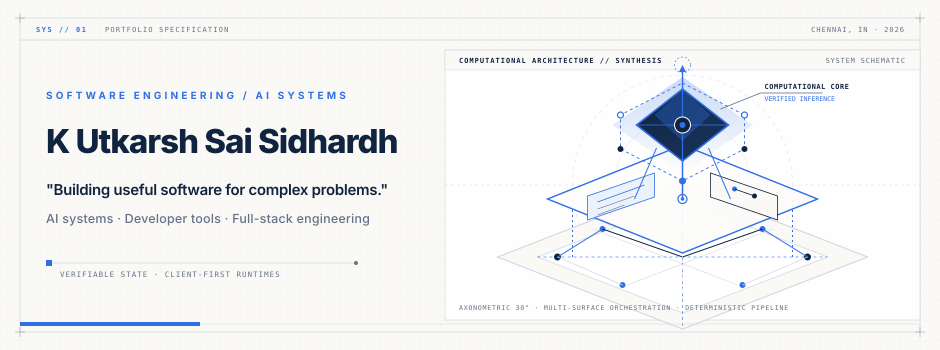
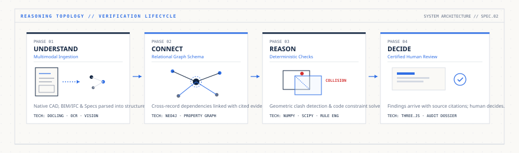
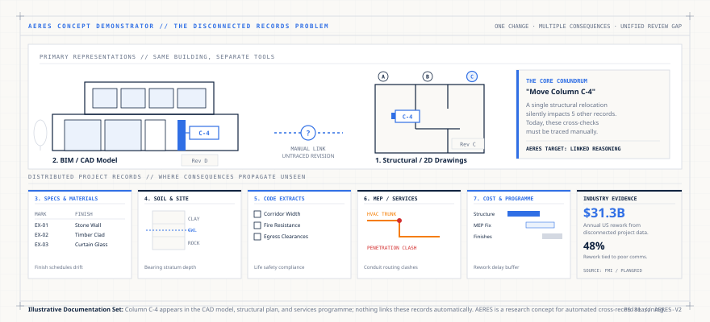
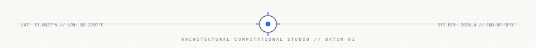

<p align="center">
  
</p>

<p align="center">
  <a href="https://github.com/utkarsh-2006">
    
  </a>
  <a href="mailto:utkarshsaisidhardh@gmail.com">
    
  </a>
  
</p>

<p align="center">
  
</p>

### `01` COMPUTATIONAL THESIS &amp; STUDIO MANIFESTO

> *"The critical failures in complex software and physical systems rarely stem from an isolated calculation. They happen in the untraced seams between raw records, distributed state, spatial boundaries, and revisions."*

I am a software engineer building **domain intelligence systems, high-utility client-side tools, and distributed state machines**. My work spans the continuum between machine learning (computer vision, document semantics, autonomous RAG pipelines) and deterministic software engineering (WebAssembly client-side document processing, browser DOM engines, authoritative WebSocket servers, and spatial graph solvers).

Whether architecting cross-discipline reasoning graphs for built-environment records, engineering zero-server WebAssembly PDF pipelines, classifying satellite thermal telemetry, or coordinating real-time multiplayer state, I build from first principles: **verifiable provenance, deterministic boundaries, and responsive local-first execution**.

<p align="center">
  
</p>

#### Core Technical Principles
* <code>EVIDENCE-FIRST PROVENANCE</code> — Predictions and findings require explicit audit trails. Systems must link directly to source records, revision timestamps, and confidence bounds rather than returning unsubstantiated assertions.
* <code>DETERMINISTIC BOUNDARIES OVER UNBOUNDED INFERENCE</code> — Language and vision models extract structure, transcribe multimodal inputs, and map intent; deterministic geometric solvers, constraint engines, and state machines enforce physical and numerical invariants.
* <code>CLIENT-FIRST &amp; NATIVE PERFORMANCE</code> — High-utility productivity tools prioritize client-side execution (WASM, local storage, browser extensions) to guarantee zero server latency, predictable execution, and structural data privacy.

<p align="center">
  
</p>

### `02` CORE ARCHITECTURAL PARADIGM

<p align="center">
  <code>01. UNDERSTAND</code> &nbsp;➔&nbsp;
  <code>02. CONNECT</code> &nbsp;➔&nbsp;
  <code>03. REASON</code> &nbsp;➔&nbsp;
  <code>04. DECIDE</code>
</p>

* **01. UNDERSTAND** `Multimodal Ingestion` — Heterogeneous sources (CAD/PDF drawings, thermal telemetry, raw DOM structures, web buyer sessions) parsed in native formats with OCR, AST parsers, and neural embeddings.
* **02. CONNECT** `Knowledge Graph &amp; State Models` — Cross-record entity resolution links isolated observations into unified relational graphs, vector indexes, or authoritative game rooms.
* **03. REASON** `Deterministic Verification` — State transitions and revisions walk explicit dependency links. Constraint engines, spatial boundary checks, and rule algorithms evaluate downstream consequences.
* **04. DECIDE** `Actionable Output` — Findings arrive with traceable citations, visual diffs, and reproducible rationale. Human operators or host applications retain final execution authority.

<p align="center">
  
</p>

### `03` FLAGSHIP ARCHITECTURAL SPECIFICATION

#### AERES 2.0 // Architectural Engineering Reasoning Engine `Concept / Research`
*An intelligence layer linking disconnected built-environment records into a unified entity graph.*

A building is recorded in many places: CAD plans, BIM models, specifications, building codes, and cost plans. When one element changes—such as shifting a column or modifying a structural grid—its impact across other disciplines is traced manually. AERES explores automated cross-discipline change-impact analysis by converting heterogeneous records into an auditable knowledge graph and executing deterministic geometric and rule solvers.

<p align="center">
  
</p>

* **Core Focus**: Cross-document entity resolution, automated blast-radius analysis, and clash detection across drawings, models, and specifications.
* **Proposed Architecture**: FastAPI · Neo4j Property Graph · PostgreSQL Spatial · PyTorch · OpenCV · Three.js
* *Status Note*: Concept and research validation stage. Capabilities depicted are proposed architectural specifications, not operational software.

<p align="center">
  
</p>

### `04` FEATURED SYSTEMS &amp; VERIFIED IMPLEMENTATIONS

Carefully curated systems with verified codebases, functional engines, and active deployments:

---

#### 1. [Layah.tools](https://github.com/utkarsh-2006/Layah.tools) `Active Development`
*High-performance, client-side WebAssembly document manipulation workspace.*

* **Problem & Architecture**: Traditional document processing utilities require uploading sensitive files to remote servers, incurring bandwidth latency and data privacy risks. Layah.tools executes PDF parsing, page manipulation, visual rendering, and reorganization entirely inside the browser using compiled WebAssembly.
* **Technical Highlights**: Powered by `@embedpdf/pdfium` (compiled WebAssembly binary of Google PDFium) and `pdf-lib`. Achieves zero-server document handling, instant client-side page rendering, drag-and-drop page restructuring, and low-latency canvas rasterization.
* **Stack**: Next.js 16 · React 19 · WebAssembly (`@embedpdf/pdfium`) · `pdf-lib` · TypeScript · Tailwind CSS
* **Source & Status**: [GitHub Repository](https://github.com/utkarsh-2006/Layah.tools) · Verified Local Codebase · Active Development

---

#### 2. [Agentic Sales Consultant / EQOVE](https://github.com/utkarsh-2006/Agentic-Sales-Consultant) `Implemented / Live Demo`
*Autonomous sales intelligence and conversion engine with intent reconstruction.*

* **Problem & Architecture**: Static sales forms and blunt chatbots fail to gauge buyer readiness. This system reconstructs visitor intent from browsing behavior, maintains conversational memory across sessions, and executes retrieval-augmented recommendations through a specialized sales reasoning backend (`Chanakya`).
* **Technical Highlights**: Multi-service architecture pairing a responsive Next.js 15 frontend with a dedicated Flask RAG API. Features vector-retrieved contextual qualification, automated objection handling, and structured lead scoring deployed across Vercel and Render.
* **Stack**: Python · Flask · LangChain · Next.js 15 · React 19 · Framer Motion · Tailwind CSS
* **Demos & Source**: [API & Engine Repo](https://github.com/utkarsh-2006/Agentic-Sales-Consultant) · [Frontend Concept Repo](https://github.com/utkarsh-2006/EQOVE) · [Live App Demo](https://agentic-sales-consultant.vercel.app) · [EQOVE Showcase](https://eqove.vercel.app)

---

#### 3. [COSMOS110](https://github.com/utkarsh-2006/COSMOS110) `Prototype / PoC`
*Geospatial satellite thermal anomaly detection and source classification pipeline.*

* **Problem & Architecture**: Thermal satellite hotspots frequently misclassify transient agricultural burns as industrial emergencies. Built for Smart India Hackathon 2026 (Problem 26162), COSMOS110 processes live NASA FIRMS telemetry to differentiate persistent industrial flares, static industrial facilities, wildfires, and crop burning.
* **Technical Highlights**: Implements spatio-temporal clustering and temporal persistence filtering across historical satellite coordinates. Combines multi-feature Scikit-learn and PyTorch classification with an interactive GIS mapping dashboard for real-time risk scoring.
* **Stack**: Python · PyTorch · Scikit-learn · Transformers · FastAPI · Leaflet / GIS · Pydantic
* **Source & Status**: [GitHub Repository](https://github.com/utkarsh-2006/COSMOS110) · Verified Source Pipeline

---

#### 4. [The Daily Ledger](https://github.com/utkarsh-2006/THE_DAILY_LEDGER) `Active Development`
*Authoritative real-time multiplayer economic board engine with room state synchronization.*

* **Problem & Architecture**: Peer-to-peer or client-heavy game clients suffer from desynchronization and client-side race conditions. The Daily Ledger implements a strictly authoritative game server where all financial transactions, property deeds, and board moves are validated on an isolated Node.js event loop.
* **Technical Highlights**: TypeScript monorepo utilizing Colyseus WebSocket rooms for binary state delta broadcasts. Features deterministic economic constraint rules, auction resolution algorithms, turn timers, and comprehensive automated test suites.
* **Stack**: TypeScript · Node.js · Colyseus · WebSockets · Vitest · Next.js · Tailwind CSS
* **Source & Status**: [GitHub Repository](https://github.com/utkarsh-2006/THE_DAILY_LEDGER) · Verified Monorepo · Active Development

---

#### 5. [TextSweep // BrowserLab](https://github.com/utkarsh-2006/TextSweep) `Implemented`
*High-utility browser DOM extraction engine for clean plain-text and Markdown conversion.*

* **Problem & Architecture**: Copying content from modern web applications pollutes the clipboard with invisible formatting, unwanted markup, broken line breaks, and tracking metadata. TextSweep traverses the live DOM tree, strips tracking artifacts and styling noise, and outputs structured, readable Markdown or clean text.
* **Technical Highlights**: Zero-dependency DOM sanitizer running in an isolated Chrome extension sandbox. Backed by rigorous Vitest test suites verifying table formatting, nested list extraction, and link integrity without remote network calls.
* **Stack**: TypeScript · Vite · Vitest · Chrome Extension Manifest V3 · DOMParser API
* **Source & Status**: [GitHub Repository](https://github.com/utkarsh-2006/TextSweep) · Packaged Build Verified

<p align="center">
  
</p>

### `05` COMPACT SYSTEMS &amp; RESEARCH INDEX

A directory of additional implementations, utilities, research specifications, and interactive engines:

| Category | System / Project | Technology Stack | Status | Focus &amp; Verified Evidence |
| :--- | :--- | :--- | :--- | :--- |
| **Decentralized** | **[Proof of Existence](https://github.com/utkarsh-2006/proof_of_existence)** | Next.js 16 · Ethers.js · Sepolia | `Implemented` | Document SHA-256 hash notarization on Ethereum Sepolia. [Live Demo](https://proof-of-existence-nine.vercel.app/) |
| **Browser Utilities** | **[DOMPilot](https://github.com/utkarsh-2006/DOMPilot)** | TypeScript · Vite · Chrome MV3 | `Implemented` | Visual element inspector &amp; selector extraction utility for developers. |
| **Browser Utilities** | **[PostCheck](https://github.com/utkarsh-2006/PostCheck)** | TypeScript · Vite · Chrome MV3 | `Implemented` | Social media post formatting and preview validator extension. |
| **Browser Utilities** | **[Stickerz](https://github.com/utkarsh-2006/Stickerz)** | JavaScript · Canvas · Chrome MV3 | `Prototype` | In-browser sticky note and visual annotation layer for active DOM sessions. |
| **Native &amp; Offline** | **[NoteThread](https://github.com/utkarsh-2006/NoteThread)** | Flutter · Dart · Hive KV · Crypto | `Implemented` | Fully offline encrypted personal workspace with zero remote network calls. |
| **Data Systems** | **[compensation-intelligence](https://github.com/utkarsh-2006/compensation-intelligence-system)** | Next.js 16 · Prisma 7 · PostgreSQL · Zod | `Prototype` | Compensation benchmarking engine with salary normalization &amp; percentile metrics. |
| **Vision &amp; Robotics** | **MicroD** | Flutter · FastAPI · React · Gemini API | `Prototype (PoC)` | Municipal waste classification taxonomy with mobile client &amp; vision PoC. |
| **Interactive Engines** | **[Chicken Gang](https://github.com/utkarsh-2006/Chicken-Gang-HTML-CSS)** | JavaScript · HTML5 Canvas · Vite | `Implemented` | 60 FPS deterministic 2D arcade physics &amp; collision engine. [Live Demo](https://chicken-gang-iota.vercel.app) |
| **Interactive Engines** | **[Chicken Gang V2](https://github.com/utkarsh-2006/Chicken-Gang-V2-GoDot)** | GDScript · Godot Engine 4.x | `Prototype` | Multi-directional Godot port featuring modular state machines &amp; physics. |
| **Decision Training** | **[TradingSimulator](https://github.com/utkarsh-2006/TradingSimulator)** | React Native · Expo · TypeScript | `Prototype` | Scenario-driven chart decision loop and trade mechanics training mobile app. |
| **Signal Research** | **A2UP** | Python · CV · Signal Processing | `Specification` | Architectural specification for multi-stage infrared thermal signal interpretation. |
| **Visual Utilities** | **[Shayde](https://github.com/utkarsh-2006/Shayde)** | JavaScript · Vite · CSS Houdini | `Prototype` | Algorithmic CSS box-shadow generator and visual styling experiment. |

<p align="center">
  
</p>

### `06` TECHNICAL CAPABILITY MATRIX

```yaml
studio_specification:
  engineer: "K Utkarsh Sai Sidhardh"
  disciplines:
    - "Cross-Record Knowledge Graphs & AEC Reasoning (AERES 2.0)"
    - "Client-Side WASM Document Engineering (Layah.tools)"
    - "Autonomous Conversion OS & RAG Systems (Agentic Sales Consultant)"
    - "Geospatial Satellite Telemetry & Thermal ML (COSMOS110)"
    - "Authoritative Multiplayer State Engines (The Daily Ledger)"
    - "High-Utility Browser Extensions & DOM Parsers (BrowserLab)"
  architectural_standards:
    - "Traceable provenance: every inference accompanied by cited evidence"
    - "Deterministic guards: logic constraints protect numerical/spatial state"
    - "Zero-server latency: client-first WASM and local-first data storage"
```

<p align="center">
  
</p>

<p align="center">
  <a href="https://github.com/utkarsh-2006"><b>GitHub Profile</b></a> &nbsp;•&nbsp;
  <a href="mailto:utkarshsaisidhardh@gmail.com"><b>Direct Email</b></a> &nbsp;•&nbsp;
  <a href="https://github.com/utkarsh-2006?tab=repositories"><b>All 17 Repositories</b></a>
</p>

<p align="center">
  <sub>Designed &amp; Engineered by <b>Utkarsh Sai Sidhardh</b> · Chennai, India</sub><br>
  <sub>Focused on ambitious systems engineering, verifiable intelligence, and robust software architecture.</sub>
</p>
